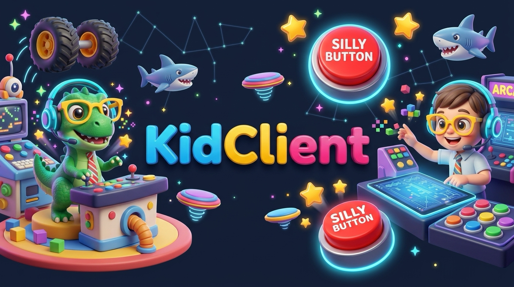

  

# 🦖 KidClient — The Parent-Consultant & Tiny-Client AI Game Studio

Welcome to the official repository for **KidClient** ([kidclient.com](https://kidclient.com) | [@kidclient on YouTube](https://youtube.com/@kidclient))!

We teach parents how to partner with their young children (ages 3–8+) to build playable video games, interactive stories, and voice toys using AI—treating the **child as the "Client / Creative Director"** and the **parent as the "Consultant / Lead Prompt Engineer."**

---

## 🚀 Start Here (Choose Your Comfort Level)

You do **not** need to know how to code or pay for expensive tools to do this with your child.

### Level 1: Zero-Install (5 Minutes, $0 Cost)
Best if you have never written a line of code and just want to use the free version of ChatGPT, Claude, or Gemini:
1. Read the **[Consultant Playbook](docs/CONSULTANT_PLAYBOOK.md)** to run a fun 5-minute "Client Discovery Call" with your kid.
2. Fill out the **[Client Brief Template](docs/CLIENT_BRIEF_TEMPLATE.md)** together.
3. Copy and paste **[KID_GAME_SYSTEM_PROMPT.md](prompts/KID_GAME_SYSTEM_PROMPT.md)** + your child's brief into Claude (Artifacts), ChatGPT (Canvas), or Gemini.
4. Play immediately in the browser or save the single `index.html` file!

### Level 2: The Tablet-Ready Starter Templates (Recommended!)
4-year-olds don't use `WASD` on a keyboard—they tap iPads and Android tablets! Instead of asking AI to invent touch joysticks, sound effects, and offline support from scratch every time, start from one of our **KidClient Shell** templates in [`/site/templates/`](site/templates/):
* 🏎️ **[Path A: 3D Worlds, Obbies & Vehicles (Three.js)](site/templates/3d-threejs/index.html)** — Includes a virtual thumbstick, big emoji action buttons, procedural Web Audio sound effects, and a starter 3D monster-truck playground.
* 🕹️ **[Path B: 2D Arcade & Platformers (HTML5 Canvas)](site/templates/2d-arcade/index.html)** — Bouncy physics, star collecting, silly sound button, and zero external image dependencies.
* 🗣️ **[Path C: Voice & Drawing Story Toy (Web Speech API)](site/templates/voice-story-toy/index.html)** — Built for pre-readers! Talks out loud to your child and listens to their voice commands + finger-painting canvas for $0 API cost.

---

## 📚 The Parent Markdown (`.md`) Resource Kit

| File | What It Does |
| :--- | :--- |
| **[`docs/CONSULTANT_PLAYBOOK.md`](docs/CONSULTANT_PLAYBOOK.md)** | How to interview your 4-year-old, keep their attention, and teach them what AI is great at vs. where AI makes silly mistakes ("hallucinations"). |
| **[`docs/CLIENT_BRIEF_TEMPLATE.md`](docs/CLIENT_BRIEF_TEMPLATE.md)** | The 5-question fill-in-the-blank spec sheet to fill out with your child before prompting. |
| **[`prompts/KID_GAME_SYSTEM_PROMPT.md`](prompts/KID_GAME_SYSTEM_PROMPT.md)** | Drop-in system prompt that instructs any AI model to output a single-file, tablet-ready, kid-safe HTML5 game with no broken assets. |
| **[`docs/FREE_STACK_CHEATSHEET.md`](docs/FREE_STACK_CHEATSHEET.md)** | How to get $0 AI models, $0 hosting on Cloudflare Pages, offline iPad PWA installation, local save states, and peer-to-peer room-code multiplayer. |

---

## 📱 How to Play Offline on an iPad / Android Tablet (PWA)

Every game in this repo (and on [kidclient.com](https://kidclient.com)) includes a Web App Manifest and Service Worker:
1. Open your game URL in **Safari (iPad/iPhone)** or **Chrome (Android)**.
2. Tap **Share** -> **Add to Home Screen**.
3. Launch it from the Home Screen! It opens **full-screen with no browser address bar**, locks accidental swipe-refreshing, and works **100% offline** on airplanes and road trips.

---

## 🌐 Links & Community

* 🌍 **Website & Live Arcade:** [kidclient.com](https://kidclient.com)
* 📺 **YouTube:** [@kidclient](https://youtube.com/@kidclient)
* 💬 **Discord Community:** Share your kid's client briefs & play other families' games!
* 🎮 **Itch.io:** [kidclient.itch.io](https://kidclient.itch.io)
* ⚡ **Game Jolt:** [@kidclient](https://gamejolt.com/@kidclient)
* 📱 **TikTok / Instagram / X:** `@kidclient`
